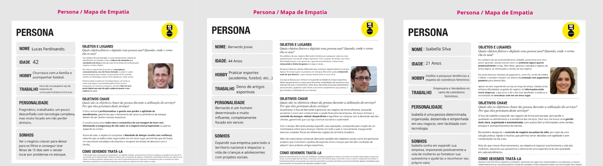
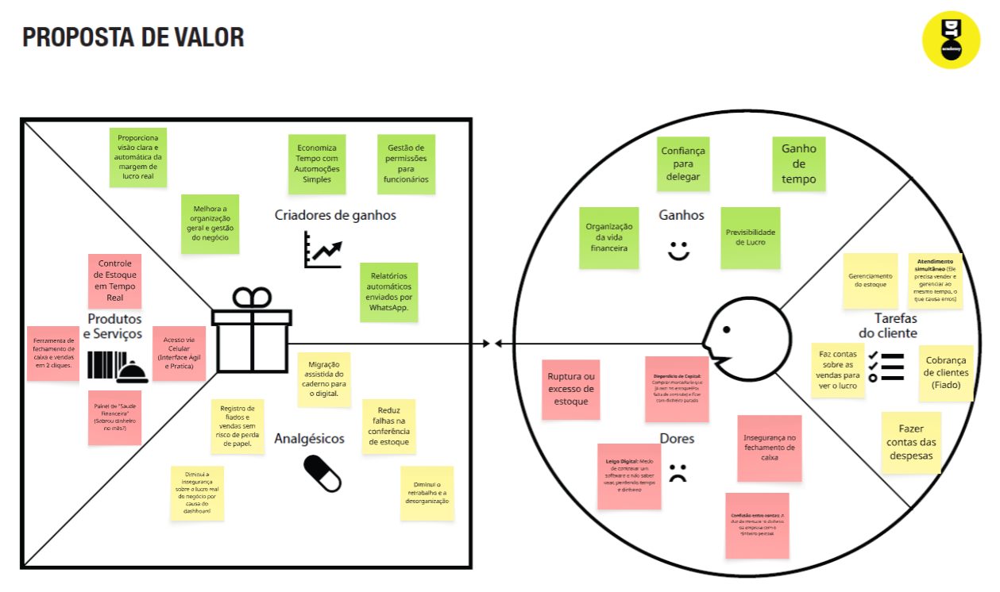
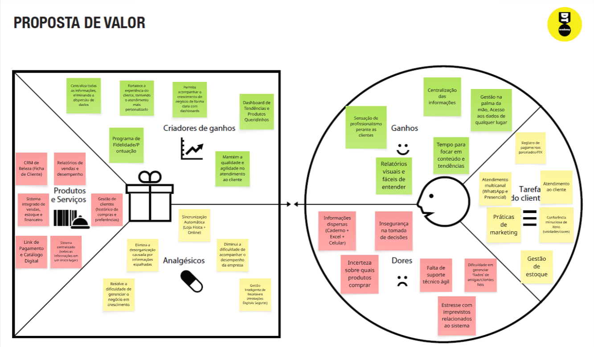
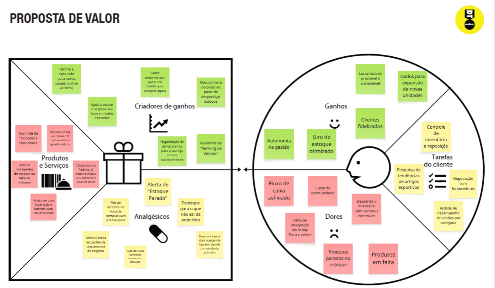
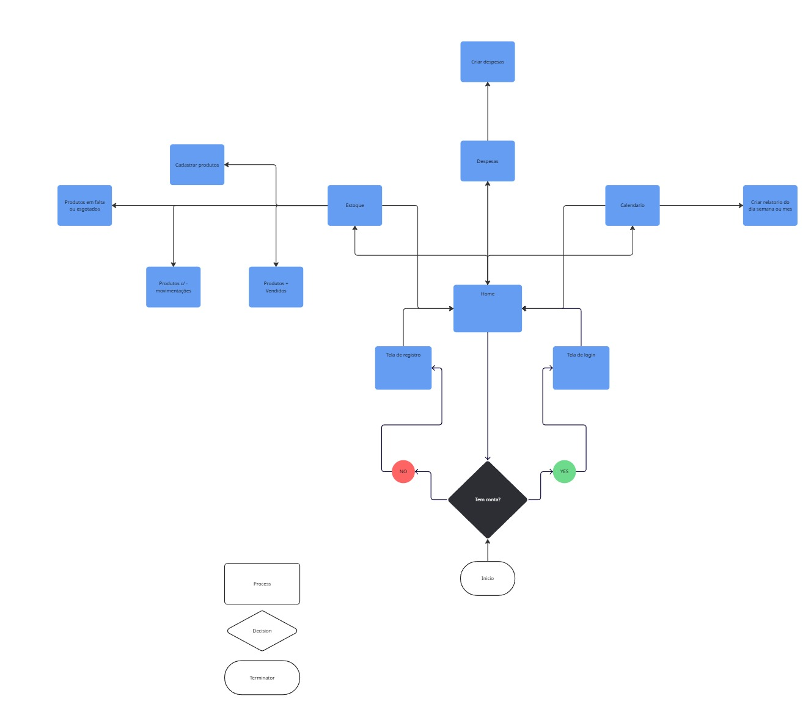
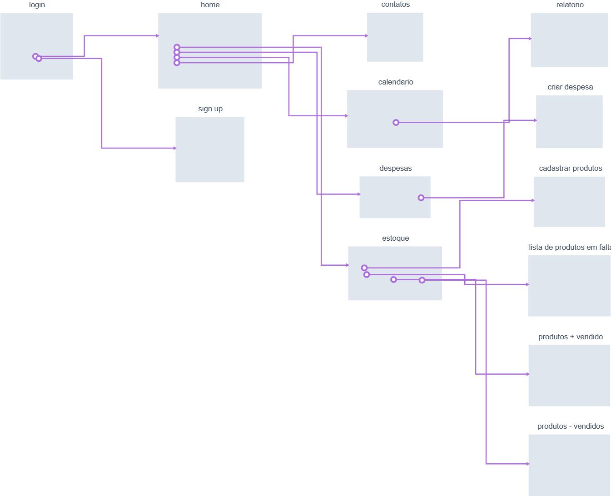
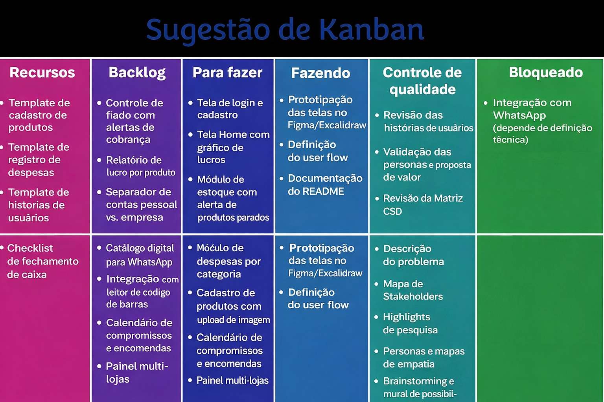
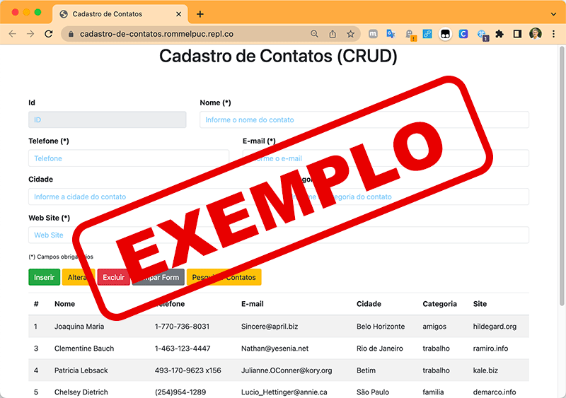

# Introdução

Informações básicas do projeto.

* **Projeto:** CalculaDor
* **Repositório GitHub:** https://github.com/ICEI-PUC-Minas-PPLES-TI/plf-es-2026-1-ti1-7620100-getech-1
* **Membros da equipe:**

  * [Lucas Araujo Asth](https://github.com/Lucasasth3)
  * [Gustavo Fernandes Vieira](https://github.com/vGustav1)
  * [Matheus Henrique Castilho Ricoy Guerra](https://github.com/Cirker1226)

A documentação do projeto é estruturada da seguinte forma:

1. Introdução
2. Contexto
3. Product Discovery
4. Product Design (**A entrega da fase de Concepção finaliza aqui**)
5. Metodologia
6. Solução
7. Referências Bibliográficas

✅ [Documentação de Design Thinking (MIRO)](files/processo-dt.pdf)

# Contexto

Detalhes sobre o espaço de problema, os objetivos do projeto, sua justificativa e público-alvo.

## Problema

Como um sistema digital simples e integrado pode ajudar o microempreendedor brasileiro a tomar decisões financeiras mais seguras no dia a dia do seu negócio?

Pequenos e microempreendedores brasileiros enfrentam dificuldades sérias para gerenciar seus negócios. A maioria ainda usa cadernos, planilhas soltas e anotações no celular para controlar vendas, estoque e fiados, ferramentas que não se comunicam entre si e deixam o dono do negócio sem uma visão clara do que está acontecendo.

Sem um sistema que una essas informações, o empreendedor não sabe exatamente quanto está ganhando, perde mercadoria por falta de controle e toma decisões baseadas em palpites. Além disso, o Brasil possui um dos sistemas tributários mais complexos do mundo, o que gera medo constante de erros fiscais e multas, especialmente para quem toca o negócio sozinho.

## Objetivos

O objetivo geral deste projeto é desenvolver um sistema web de gestão voltado para pequenos e microempreendedores, que centralize em um só lugar o controle de vendas, estoque, fiado e financeiro de forma simples e acessível.

Como objetivos específicos, o projeto busca:

- Permitir que o empreendedor visualize sua margem de lucro real, descontando custos e impostos automaticamente de seu faturamento.
- Criar um controle de estoque com alertas inteligentes, evitando tanto a falta quanto o excesso de produtos parados.
- Oferecer uma interface simples o suficiente para ser usada por quem ainda utiliza caderno e calculadora no dia a dia.

## Justificativa

Ao pesquisar sobre os desafios dos pequenos negócios no Brasil, o grupo percebeu que a maioria dos empreendedores que conhecemos no dia a dia, donos de mercadinhos, lojas de bairro, cosméticos, oficinas, etc... Acabam sofrendo com o mesmo problema: trabalha muito, vende, mas não sabe se está tendo lucro de verdade. Essa dor é próxima, real e afeta milhões de brasileiros, o que tornou o tema urgente e relevante para o grupo desenvolver uma solução.

Este projeto busca desenvolver um sistema web de gestão que una vendas, estoque e financeiro em um único lugar, apresentando funcionalidades como controle de estoque com alertas, registro de fiado e visualização do lucro real de forma automática, para microempreendedores que precisam organizar seu negócio mas não têm tempo ou familiaridade com a tecnologia.

Pesquisas do SEBRAE apontam que a ausência de controle de fluxo de caixa e a dificuldade em separar contas pessoais das empresariais são as principais causas de falência precoce de pequenos negócios. Empresas que monitoram custos e despesas diariamente apresentam taxas de sucesso até 30% maiores.

Além disso, o Brasil é o país onde as empresas gastam mais tempo com burocracia fiscal no mundo, cerca de 1.500 horas por ano. Esse peso cai diretamente sobre o pequeno empresário, que precisa focar na operação do negócio.

A pesquisa TIC Empresas realizada no ano de 2024 reforça que muitos pequenos negócios ainda utilizam sistemas desconectados, como planilhas isoladas, o que gera desperdício de recursos e "dinheiro parado" em estoque. Diante disso, o grupo identificou a necessidade urgente de uma ferramenta que una vendas, estoque e financeiro em um único lugar, de forma intuitiva e acessível para quem não tem familiaridade com tecnologia.

## Público-Alvo

O sistema é voltado para microempreendedores brasileiros de diferentes perfis, que gerenciam seus negócios de forma independente e sofrem com a falta de organização financeira e operacional.

Com base nas pesquisas realizadas, foram identificados três perfis principais de usuários:

- **Empreendedores com baixa familiaridade com tecnologia** (ex: donos de lojas de materiais de construção, mercadinhos de bairro): usam caderno e calculadora, têm desconfiança de sistemas complexos e precisam de uma solução rápida e simples de aprender.
- **Empreendedores digitais em crescimento** (ex: donas de lojas de cosméticos, brechós online): já usam o celular para vender, mas sofrem com informações dispersas em vários aplicativos diferentes.
- **Empresários focados em expansão** (ex: donos de lojas de artigos esportivos): buscam dados concretos para tomar decisões estratégicas e escalar o negócio sem perder o controle financeiro.

# Product Discovery

## Etapa de Entendimento

Para compreender com maior profundidade o problema enfrentado pelos pequenos e médios empreendedores brasileiros, utilizamos a metodologia de Design Thinking, estruturando nosso processo em quatro artefatos principais.

A **Matriz de Alinhamento (CSD)** foi o ponto de partida para organizar o que sabemos, o que suspeitamos e o que ainda precisamos descobrir. Entre nossas certezas, identificamos que um sistema com relatórios automáticos ajuda na visualização do desempenho do negócio, que o controle financeiro é fundamental para a sobrevivência de uma empresa e que informações organizadas apoiam diretamente a tomada de decisões.

Já nossas suposições apontam que muitos microempreendedores não utilizam sistemas automatizados por considerá-los caros ou complexos demais, que a maioria mistura finanças pessoais com empresariais e que boa parte não analisa dados ou relatórios para tomar decisões. 

Por fim, nossas principais dúvidas giram em torno de questões como o nível de alfabetização digital do nosso cliente-alvo, a disposição do pequeno empresário em confiar dados financeiros a uma plataforma web e o que de fato motivaria esse empreendedor a abandonar o método atual em favor de uma solução digital.

O **Mapa de Stakeholders** nos permitiu identificar e classificar todos os grupos envolvidos no ecossistema do problema. As pessoas fundamentais são os próprios microempreendedores e seus funcionários, que vivem diariamente as dores da desorganização financeira e operacional. 

As pessoas importantes, que podem facilitar ou dificultar a adoção da solução, incluem investidores e sócios, fornecedores de mercadorias, empresas de software de pagamento e o SEBRAE, parceiro estratégico no desenvolvimento de pequenos negócios.

Por fim, as pessoas influenciadoras, incluem órgãos reguladores, sindicatos, bancos, instituições de crédito, governo, Receita Federal, mídia especializada e comunidades de empreendedores.

A pesquisa revelou que pequenos negócios não fecham por falta de vendas, mas por desorganização financeira e estoque mal gerido. O excesso de burocracia tributária agrava ainda mais esse cenário. Ferramentas complexas são rapidamente abandonadas simplicidade é essencial. Faturamento alto não garante lucro: sem centralização de vendas, estoque e financeiro em um único lugar, o empreendedor trabalha no escuro e toma decisões baseadas em palpites.

## Etapa de Definição

### Personas



O projeto identificou três personas que representam os principais perfis de microempreendedores impactados pelo problema.

Lucas Ferdinando, dono de materiais de construção, representa o empreendedor tradicional que ainda depende de caderno e calculadora, cuja maior dor é não saber sua margem de lucro real e perder dinheiro com fiado esquecido. 

Isabella Silva, empresária de cosméticos, representa o perfil jovem e digital, mas que sofre com informações dispersas em múltiplos canais e precisa centralizar vendas, estoque e atendimento em um único lugar. 

Bernardo Josias, dono de artigos esportivos, representa o empreendedor em expansão, cujo principal problema é o capital imobilizado em estoque parado por falta de dados concretos para decisões de compra. 

Os três compartilham as mesmas dores centrais mapeadas nos mapas de empatia: ausência de visão financeira real, processos manuais que consomem tempo e a necessidade urgente de uma ferramenta simples, intuitiva e que centralize todas as informações do negócio.

# Product Design

Nesse momento, vamos transformar os insights e validações obtidos em soluções tangíveis e utilizáveis. Essa fase envolve a definição de uma proposta de valor, detalhando a prioridade de cada ideia e a consequente criação de wireframes, mockups e protótipos de alta fidelidade, que detalham a interface e a experiência do usuário.

## Histórias de Usuários

Com base na análise das personas foram identificadas as seguintes histórias de usuários:

| EU COMO... `PERSONA` | QUERO/PRECISO... `FUNCIONALIDADE` | PARA... `MOTIVO/VALOR` |
| --------------------- | ---------------------------------- | ----------------------- |
| Isabella Silva, proprietária de loja de cosméticos que lida com informações dispersas | Centralizar o registro de vendas físicas e digitais em um único aplicativo | Ter uma gestão clara, organizada e automatizada do meu negócio na palma da mão |
| Bernardo Josias, empresário focado em expansão que sofre com estoque parado | Visualizar relatórios de giro de estoque e lucratividade real | Tomar decisões baseadas em dados confiáveis e evitar desperdício de capital |
| Lucas Ferdinando, empreendedor que ainda utiliza cadernos e teme sistemas complexos | Uma interface simples para registrar vendas e "fiados" com backup em nuvem | Eliminar a insegurança no fechamento de caixa e conseguir delegar tarefas com confiança |
| Ricardo, dono de uma oficina mecânica preocupado com a rentabilidade de cada serviço | Uma forma de transformar orçamentos em ordens de serviço, separando custo de peças e mão de obra | Cobrar o valor justo do cliente e saber o lucro real exato de cada reparo |
| Mariana, confeiteira autônoma que vende por encomenda e precisa gerenciar a produção | Uma agenda integrada com prazos de entrega e controle de sinais recebidos | Não esquecer pedidos e garantir que o valor cobrado cubra os ingredientes e o tempo de produção |
| Seu Jorge, proprietário de uma mercearia de bairro que precisa atender rápido e estar legalizado | Emissão simplificada de nota fiscal integrada ao leitor de código de barras | Evitar filas no balcão e cumprir as obrigações fiscais sem complicação |
| Camila, dona de um brechó que precisa manter o catálogo de peças únicas atualizado | Cadastrar fotos e descrições individuais para cada item com baixa automática após a venda | Evitar vender o mesmo produto para duas pessoas e manter o estoque real |
| Felipe, dono de uma pequena cafeteria que começou a contratar funcionários | Controle de acesso de funcionários, delegando tarefas sem expor dados financeiros sensíveis | Que meus atendentes operem o sistema com segurança enquanto eu foco na gestão |
| Dona Neuza, costureira que convive com a cultura do "pagar depois" | Um histórico de "fiado" com lembretes de cobrança via mensagem | Reduzir a inadimplência e não esquecer de cobrar os serviços realizados |

## Proposta de Valor

##### Proposta de valor para Lucas Ferdinando

Lucas precisa substituir o caderno e a calculadora por uma solução simples e sem necessidade de treinamento técnico. O sistema oferece controle de estoque em tempo real, gestão de fiados, relatórios automáticos via WhatsApp e fechamento de caixa ágil. Com isso, ele ganha confiança para delegar tarefas, visão clara da sua margem de lucro real e organização financeira sem abandonar a agilidade no atendimento.



##### Proposta de valor para Isabella Silva

Isabella precisa centralizar informações que hoje estão dispersas em vários canais. O sistema oferece CRM, relatórios visuais de desempenho, catálogo digital e sincronização entre loja física e online. Com isso, ela ganha controle do negócio na palma da mão, toma decisões com mais segurança e libera tempo para focar em conteúdo, tendências e crescimento.



##### Proposta de valor para Bernardo Josias

Bernardo precisa de dados concretos para parar de imobilizar capital em estoque parado e se preparar para expandir. O sistema oferece alertas inteligentes de reposição, ranking de vendas por produto, calculadora de pedidos e integração entre loja física e online. Com isso, ele ganha giro de estoque otimizado, lucratividade previsível e autonomia para tomar decisões estratégicas de expansão.



## Projeto de Interface

Artefatos relacionados com a interface e a interacão do usuário na proposta de solução.

### Wireframes

Estes são os protótipos de telas do sistema.

##### TELA GERAL

O sistema é composto por seis telas principais. O Login e o Sign Up são as telas de entrada, com campos simples de autenticação e cadastro.

A Home apresenta o painel principal com menu lateral de navegação e um gráfico de lucros para visão geral do negócio. A tela de Estoque exibe dois painéis comparativos junto à lista de itens cadastrados e acesso rápido para adicionar novos produtos.

O Cadastro de Produtos conta com campos de texto e espaço para upload de imagem. A tela de Despesas organiza os gastos em categorias fixas como fornecedor, aluguel e funcionários, com a possibilidade de adicionar categorias personalizadas. 

Por fim, o Calendário oferece uma visão semanal para o usuário registrar e acompanhar os compromissos do dia a dia do negócio


### User Flow

O fluxo começa com o Início, onde o sistema verifica se o usuário já possui conta. Caso não tenha, é direcionado para a Tela de Registro; caso já tenha, segue para a Tela de Login. Após a autenticação, o usuário acessa a Home, ponto central de navegação do sistema, a partir da qual pode acessar três módulos principais: Estoque, Despesas e Calendário.




### Protótipo Interativo

O protótipo interativo do Sistema Inteligente de Gestão permite navegar pelas principais telas da aplicação. A partir do fluxo de autenticação, o usuário acessa a Home e pode explorar os módulos de Estoque, Despesas e Calendário, simulando o dia a dia real de um pequeno empreendedor no controle do seu negócio.

✅ [Protótipo Interativo (MarvelApp)](https://marvelapp.com/prototype/8435682)

# Metodologia

Detalhes sobre a organização do grupo e o ferramental empregado.

## Ferramentas

Relação de ferramentas empregadas pelo grupo durante o projeto.

| Ambiente                    | Plataforma | Link de acesso                                     |
| --------------------------- | ---------- | -------------------------------------------------- |
| Editor de Código          | VsCode     | https://code.visualstudio.com |
| Repositório de código     | GitHub     | https://github.com/ICEI-PUC-Minas-PPLES-TI/plf-es-2026-1-ti1-7620100-getech-1      |
| Processo de Design Thinking | Miro       | https://miro.com/app/board/uXjVGzT-OR8=/        |
| Protótipo de Wireframe       | Excalidraw  | https://excalidraw.com/#json=D-J6ytKPCF_DV2lBvjxSo,H6ETVxo4QD0ZaqdCc7sXXw   |
| Protótipo Interativo       | MarvelApp  | https://marvelapp.com/prototype/8435682   |
|                             |            |                                                    |


## Gerenciamento do Projeto

## Divisão de Papéis

| Membro | Responsabilidades |
| ------ | ----------------- |
| Lucas Araujo Asth | Etapa de Entendimento e Exploração, Ideia do Projeto, PDF e Apresentação, Projeto de Interface |
| Gustavo Fernandes Vieira | Etapa de Entendimento e Exploração, Ideia do Projeto, Projeto de Interface |
| Matheus Henrique | Etapa de Entendimento e Exploração, Documentação, Projeto de Interface |
| Gabriel Cotta | — |
| Caio Olimpo | — |
| Bernardo Guerra | — |



O desenvolvimento do projeto seguiu a metodologia de Design Thinking para a etapa de entendimento e ideação, estruturada em cinco artefatos: Matriz CSD, Mapa de Stakeholders, Entrevistas Qualitativas, Highlights de Pesquisa e Personas com Proposta de Valor. Essa abordagem permitiu que o grupo compreendesse profundamente as dores dos microempreendedores antes de propor qualquer solução.

Para a etapa de desenvolvimento, o grupo adotou o Framework Scrum, organizando as tarefas em um quadro Kanban com as colunas: Recursos, Backlog, Para Fazer, Fazendo, Controle de Qualidade, Feito e Bloqueado. O Backlog foi alimentado com as funcionalidades priorizadas no Mapa de Priorização do board, considerando o impacto e o custo de cada entrega.

As sprints foram organizadas priorizando primeiro as funcionalidades essenciais autenticação, estoque e despesas — evoluindo para recursos mais complexos como alertas inteligentes e relatórios automáticos.

# Solução Implementada

Esta seção apresenta todos os detalhes da solução criada no projeto.

## Vídeo do Projeto

O vídeo a seguir traz uma apresentação do problema que a equipe está tratando e a proposta de solução. ⚠️ EXEMPLO ⚠️

[](https://www.youtube.com/embed/70gGoFyGeqQ)

> ⚠️ **APAGUE ESSA PARTE ANTES DE ENTREGAR SEU TRABALHO**
>
> O video de apresentação é voltado para que o público externo possa conhecer a solução. O formato é livre, sendo importante que seja apresentado o problema e a solução numa linguagem descomplicada e direta.
>
> Inclua um link para o vídeo do projeto.

## Funcionalidades

Esta seção apresenta as funcionalidades da solução.Info

##### Funcionalidade 1 - Cadastro de Contatos ⚠️ EXEMPLO ⚠️

Permite a inclusão, leitura, alteração e exclusão de contatos para o sistema

* **Estrutura de dados:** [Contatos](#ti_ed_contatos)
* **Instruções de acesso:**
  * Abra o site e efetue o login
  * Acesse o menu principal e escolha a opção Cadastros
  * Em seguida, escolha a opção Contatos
* **Tela da funcionalidade**:



> ⚠️ **APAGUE ESSA PARTE ANTES DE ENTREGAR SEU TRABALHO**
>
> Apresente cada uma das funcionalidades que a aplicação fornece tanto para os usuários quanto aos administradores da solução.
>
> Inclua, para cada funcionalidade, itens como: (1) titulos e descrição da funcionalidade; (2) Estrutura de dados associada; (3) o detalhe sobre as instruções de acesso e uso.

## Estruturas de Dados

Descrição das estruturas de dados utilizadas na solução com exemplos no formato JSON.Info

##### Estrutura de Dados - Contatos   ⚠️ EXEMPLO ⚠️

Contatos da aplicação

```json
  {
    "id": 1,
    "nome": "Leanne Graham",
    "cidade": "Belo Horizonte",
    "categoria": "amigos",
    "email": "Sincere@april.biz",
    "telefone": "1-770-736-8031",
    "website": "hildegard.org"
  }
  
```

##### Estrutura de Dados - Usuários  ⚠️ EXEMPLO ⚠️

Registro dos usuários do sistema utilizados para login e para o perfil do sistema

```json
  {
    id: "eed55b91-45be-4f2c-81bc-7686135503f9",
    email: "admin@abc.com",
    id: "eed55b91-45be-4f2c-81bc-7686135503f9",
    login: "admin",
    nome: "Administrador do Sistema",
    senha: "123"
  }
```

> ⚠️ **APAGUE ESSA PARTE ANTES DE ENTREGAR SEU TRABALHO**
>
> Apresente as estruturas de dados utilizadas na solução tanto para dados utilizados na essência da aplicação quanto outras estruturas que foram criadas para algum tipo de configuração
>
> Nomeie a estrutura, coloque uma descrição sucinta e apresente um exemplo em formato JSON.
>
> **Orientações:**
>
> * [JSON Introduction](https://www.w3schools.com/js/js_json_intro.asp)
> * [Trabalhando com JSON - Aprendendo desenvolvimento web | MDN](https://developer.mozilla.org/pt-BR/docs/Learn/JavaScript/Objects/JSON)

## Módulos e APIs

Esta seção apresenta os módulos e APIs utilizados na solução

**Images**:

* Unsplash - [https://unsplash.com/](https://unsplash.com/) ⚠️ EXEMPLO ⚠️

**Fonts:**

* Icons Font Face - [https://fontawesome.com/](https://fontawesome.com/) ⚠️ EXEMPLO ⚠️

**Scripts:**

* jQuery - [http://www.jquery.com/](http://www.jquery.com/) ⚠️ EXEMPLO ⚠️
* Bootstrap 4 - [http://getbootstrap.com/](http://getbootstrap.com/) ⚠️ EXEMPLO ⚠️

> ⚠️ **APAGUE ESSA PARTE ANTES DE ENTREGAR SEU TRABALHO**
>
> Apresente os módulos e APIs utilizados no desenvolvimento da solução. Inclua itens como: (1) Frameworks, bibliotecas, módulos, etc. utilizados no desenvolvimento da solução; (2) APIs utilizadas para acesso a dados, serviços, etc.

# Referências

As referências utilizadas no trabalho foram:

* SOBRENOME, Nome do autor. Título da obra. 8. ed. Cidade: Editora, 2000. 287 p ⚠️ EXEMPLO ⚠️

> ⚠️ **APAGUE ESSA PARTE ANTES DE ENTREGAR SEU TRABALHO**
>
> Inclua todas as referências (livros, artigos, sites, etc) utilizados no desenvolvimento do trabalho.
>
> **Orientações**:
>
> - [Formato ABNT](https://www.normastecnicas.com/abnt/trabalhos-academicos/referencias/)
> - [Referências Bibliográficas da ABNT](https://comunidade.rockcontent.com/referencia-bibliografica-abnt/)
